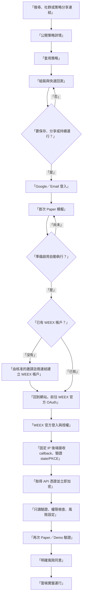

# CryptoBot Labs：WEEX OAuth＋網站改版規範

- 文件狀態：可交付下一個 Codex 對話執行
- 制定日期：2026-07-14（Asia/Taipei）
- 適用專案：目前 Git repository 根目錄（以下以 `<repo-root>` 表示）
- 產品方向：停止把桌面 Agent 當成主要使用流程，改為網站登入、WEEX OAuth、雲端執行
- 第一階段目標：一個工程日內完成可操作的全站展示版
- 正式實盤狀態：尚未核准；必須完成本文件的正式上線門檻

> 本規範是產品、UX、工程與資安交接文件，不是法律或投資建議。任何返佣、隱私、風險揭露與服務條款仍應由熟悉營運地區的法律專業人士審閱。

## 1. 結論與執行原則

本次改版不重做既有策略產品，而是保留目前的策略市集、組裝車間、歷史回測、風控、運行監控與 WEEX V3 交易核心，替換三個關鍵層：

1. 把 ChatGPT 工作區登入改為 Google／Email 登入。
2. 把「下載 Agent、掃 QR、手動輸入 API」改為 WEEX OAuth。
3. 新增公開策略分享、KOL／BD 推廣歸因與管理後台。

網站最大的商業轉換是讓新訪客自然成為可使用 WEEX API 的自動交易用戶，但前台文案不得寫成「替平台拉新」或「為了返佣」。前台只溝通真實的用戶價值：

- 不用安裝桌面程式。
- 不用複製貼上 API Key。
- 可以先看策略、組裝、回測與模擬。
- 通過模擬與風險設定後，才可啟用自動交易。
- 可隨時暫停、斷開 WEEX 連線。

這不代表可以隱藏推薦關係。凡是使用含推薦碼的 WEEX 註冊連結，按鈕附近必須用簡短文字揭露「此連結可能包含推薦關係，您的使用費用不因此增加」，並連到完整的推廣揭露頁。不得使用自動跳轉、偽裝按鈕或其他暗黑模式。

## 2. 產品目標與非目標

### 2.1 產品目標

- 新手不用理解 API Key、Node.js、Docker、Agent 或伺服器，也能完成第一次模擬。
- 訪客在登入前就能看見策略價值，登入只出現在保存、分享或執行的必要時刻。
- Google 與 Email 登入共用同一份會員資料，後台可管理用戶、角色、來源與 WEEX 連線狀態。
- WEEX 是唯一可連接與下單的交易所；不得新增其他交易所入口或抽象成多交易所賣點。
- 每個公開策略都能產生穩定分享網址、SEO／Open Graph 預覽與可複製版本。
- 經管理員核准的 KOL／BD 可綁定自己的 WEEX VIP code 或邀請註冊網址，從自己的策略分享頁導流。
- 公開策略與共用行情盡量使用快取；只有真正運行中的策略才消耗私有 WebSocket 與交易資源。
- 第一天完成可點擊、可展示的主要旅程；正式 OAuth 與實盤另外通過安全門檻。

### 2.2 非目標

- 第一天不接收、不保存任何真實 WEEX API Secret／Passphrase。
- 第一天不送出真實訂單，也不把模擬授權畫面冒充 WEEX 官方頁。
- 不保證收益、不以單一報酬率引導新手、不隱藏最大回撤、費用、滑價與資料日期。
- 不在第一天刪除 `apps/agent`；只從網站主流程移除，保留為封存與回復參考。
- 不在未獲 WEEX 書面確認前承諾 KOL 一定取得返佣，也不嘗試更改既有 WEEX 用戶的推薦關係。

## 3. 最佳使用流程



### 3.1 匿名訪客

1. 從搜尋、KOL 分享、社群貼文或首頁進入公開策略頁。
2. 不登入即可查看策略用途、適用市場、時間週期、風險級別、模擬績效、最大回撤、交易次數、資料區間與更新時間。
3. 按「套用此策略」進入組裝車間，策略版本與推廣來源一起保留。
4. 可進行一次快速預覽回測；完整歷史保存與重複回測才要求登入。
5. 按「保存策略」「建立分享連結」或「開始模擬」時，開啟登入頁／對話框。

### 3.2 Google／Email 登入

登入頁只提供兩個明確選項：

- `使用 Google 繼續`
- `使用 Email 繼續`：優先採一次性驗證碼或 Magic Link，避免新手記密碼與重設密碼。

登入完成後必須回到原來的策略、組裝設定與來源歸因，不能把用戶丟回首頁。Google 與 Email 若為同一已驗證信箱，應使用 Supabase 的身份連結規則避免重複會員；禁止以可由用戶修改的 `user_metadata` 判斷管理員或 KOL 權限。

### 3.3 第一次 Paper 模擬

1. 登入後先顯示白話摘要：何時進場、何時離場、單次最大資金比例與停止條件。
2. 預設使用 Paper，不要求先連接 WEEX。
3. 建議解鎖實盤的最低條件為：至少完成一次 30 分鐘模擬或 10 次有效策略評估，且沒有資料中斷、無效訂單或風控阻擋未處理。
4. 顯示「這是模擬，不會送出真實訂單」。Paper 與實盤使用不同顏色、標籤與確認步驟。
5. 模擬通過後才出現「啟用自動執行」，而不是一進站就要求開 WEEX 帳戶。

### 3.4 WEEX 帳戶分流

按「啟用自動執行」後先詢問：

- `我已有 WEEX 帳戶`：直接進入 OAuth 說明頁。
- `我還沒有 WEEX 帳戶`：顯示「建立交易帳戶」並使用已鎖定的推廣歸因連結。

新用戶點擊註冊連結時：

- 用新分頁開啟經管理員核准的 `weex.com` 邀請網址。
- 網站保留原策略與 `return_to` 狀態。
- 回到網站後按「我已完成註冊」，再前往 WEEX OAuth。
- 不把 OAuth 說成註冊本身；OAuth 是對既有／剛建立的 WEEX 帳戶進行授權。

### 3.5 WEEX OAuth

網站上的四格流程改為：

1. `準備帳戶`：已有帳戶或前往建立。
2. `WEEX 官方授權`：離開本站前顯示將授權的能力與風險。
3. `安全驗證`：callback 成功後檢查連線、可讀、可交易與提領權限。
4. `先模擬運行`：選擇策略與風險上限，第一個運行固定為 Paper／Demo。

前台不得要求用戶輸入 API Key、Secret、Passphrase，也不得把 `clientSecret`、PKCE verifier、access token 或 WEEX API 憑證送到瀏覽器。

### 3.6 實盤解鎖

實盤前必須全部成立：

- WEEX OAuth 連線狀態正常。
- 只讀帳戶查詢成功。
- 可交易權限明確為可用。
- 提領權限明確為不存在；`unknown` 一律不解鎖。
- Paper／Demo 通過最低條件。
- 用戶已設定每筆最大金額、單日最大虧損、允許交易對、最大槓桿、最大同時持倉與連續錯誤停止條件。
- 用戶在實盤確認畫面再次輸入確認文字並同意風險告知。

網站與後台都要有「立即停止」；停止後先阻擋新訂單，再取消未成交訂單，最後同步持倉與訂單狀態。不得用停止按鈕暗示會自動平掉所有持倉，除非該功能已被獨立實作與再次確認。

## 4. 網站資訊架構與頁面改版

### 4.1 公開導覽

公開導覽保留並簡化為：

- `探索策略` → `/bots`
- `組裝策略` → `/workshop`
- `排行榜` → `/leaderboard`
- `我的運行` → `/runs`（未登入時導向登入）
- 右側：`登入` 或用戶選單

移除首頁與導覽中的 Agent 下載語意。現在的 `WEEX API · 推薦` 改成較自然且正確的 `WEEX 專用`。網站不得暗示支援其他交易所。

### 4.2 首頁 `/`

首屏建議文案：

- 主標：`把交易想法，組成能先模擬的自動策略。`
- 副標：`不用安裝程式、不用貼 API 金鑰。挑選或組裝策略，先回測與模擬，再安全連接 WEEX。`
- 主按鈕：`探索策略`
- 次按鈕：`從空白組裝`
- 信任訊息：`先模擬`、`可隨時停止`、`WEEX OAuth`

首頁內容順序：

1. 價值主張與策略入口。
2. 熱門／新手友善策略。
3. 三步流程：挑選 → 模擬 → 自動運行。
4. 真實且有完整假設的模擬績效範例。
5. 策略組裝賣點。
6. 安全連接 WEEX 說明。
7. 最終 CTA：`先選一個策略`。

將現有「回測與下載」改為「回測與模擬」，將「本機代理保存憑證」改為「WEEX 官方授權，憑證由後端加密保存」。

### 4.3 策略市集 `/bots`

每張策略卡至少顯示：

- 名稱、現貨／合約、交易對、時間週期。
- 新手友善程度與風險等級。
- 模擬報酬、最大回撤、交易次數、資料日期。
- `查看策略` 與 `直接套用`。

排序預設不能只依報酬，建議採「完成度與風險調整後的熱門度」。所有績效附近固定顯示「模擬資料，不代表未來績效」。

### 4.4 公開策略詳情 `/bots/[id]`

最快方案是擴充現有 `/bots/[id]`，不要第一天另建重複的 `/strategies/[slug]`。

新增：

- 穩定的公開 slug 與 canonical URL。
- Open Graph 標題、描述與預覽圖。
- 策略白話摘要、風險與模擬證據。
- `套用此策略`、`分享`、`複製連結`。
- 發布者顯示名稱／品牌別名；永不公開 Email。
- 可選的 `允許複製`、`顯示原始碼`、`公開／不公開連結／私人`。
- 分享頁綁定不可變的策略版本，避免作者更新後歷史分享內容悄悄改變。

### 4.5 組裝車間 `/workshop`

- 匿名狀態可組裝並把草稿存於瀏覽器。
- 快速預覽回測使用有限資料與快取，不建立永久資料列。
- 保存、公開分享、完整歷史回測與持續運行才要求登入。
- 登入後恢復所有積木、參數、程式碼、策略版本與推廣歸因。
- Package／Agent 下載區改為 `保存策略`、`建立分享連結`、`開始 Paper`。

### 4.6 WEEX 連線 `/connections`

完全替換 Agent 下載、QR Code 與裝置卡，但第一天不要刪除舊元件檔案。新版顯示第 3.5 節的 OAuth 四格流程與以下狀態：

- 未登入。
- 已登入、尚未準備 WEEX 帳戶。
- 等待 WEEX OAuth。
- OAuth 處理中。
- 已連接、權限驗證中。
- 已連接、可開始 Paper。
- 連線過期／失效。
- 已斷開。

### 4.7 我的運行 `/runs` 與 `/runs/[id]`

保留現有運行、風險、停止、訂單與活動紀錄介面，把「裝置／Agent」改為「雲端執行器」。顯示：

- Paper／Demo／Live 明確標籤。
- 執行狀態、上次心跳、行情狀態、下一次評估時間。
- 當日損益、風險用量、未成交訂單與持倉摘要。
- 暫停、停止、解除 WEEX 連線。

### 4.8 登入 `/auth`

新增品牌化登入頁或對話框，支援 Google 與 Email OTP／Magic Link。登入前後的 `return_to`、策略草稿與 `via` 歸因必須保留。

### 4.9 管理後台 `/admin/users`、`/admin/promoters`

`/admin/users` 欄位：

- 建立日期、顯示名稱、Email、登入方式。
- 角色、帳號狀態、來源、推廣者。
- WEEX 連線狀態、首次 Paper、目前 Live、最後活動時間。
- 風險／錯誤旗標；WEEX UID 如需顯示應遮罩。

管理動作：

- 停權並停止新訂單。
- 調整 `user / creator / kol / bd / admin` 角色。
- 核准／停用推廣者。
- 解除本站 WEEX 連線與排程憑證刪除。
- 匯出不含交易憑證的 CSV。

管理員永遠不能在後台看見完整 API Key、Secret 或 Passphrase。Supabase Dashboard 可作為身份資料的營運備援；自訂後台用於產品狀態與推廣歸因。

## 5. 策略分享與外部流量

### 5.1 分享網址

標準形式：

```text
https://品牌網域/bots/{public-slug}?via={promoter-slug}&utm_source={source}&utm_campaign={campaign}
```

`via` 只能是本站已核准的 promoter slug，不能直接放任意外部 URL 或 WEEX code。伺服器依 slug 取出核准的邀請網址，避免釣魚、開放重新導向與連結被竄改。

### 5.2 公開策略資料白名單

公開 API／頁面只可輸出：

- 公開標題、摘要、分類、交易市場與策略版本。
- 經作者同意的積木／參數或原始碼。
- 模擬數據、假設、資料範圍、費用、滑價、生成時間。
- 作者別名、品牌頭像與公開介紹。

禁止輸出：

- Email、內部 user id、WEEX UID、連線 id。
- OAuth token、API credentials、加密材料或內部執行器資訊。
- 私人策略、未公開版本、Live 帳戶餘額與持倉。

### 5.3 歸因規則

- 匿名 first-touch 與 last-touch 都記錄，預設有效期 30 天。
- 用戶建立網站帳號後把匿名歸因合併到會員，但不得覆寫較早已鎖定的 WEEX 註冊來源。
- 用戶點擊「建立 WEEX 帳戶」時鎖定 promoter；之後換頁或再次分享不得靜默改成別人。
- 分析可看 last-touch，返佣歸屬只能採 WEEX 實際確認的推薦關係。
- 已有 WEEX 帳戶或已綁其他推薦碼的用戶，不承諾可重新歸因。

## 6. KOL／BD 推廣功能

### 6.1 角色申請與核准

KOL／BD 在帳號設定提交：

- 公開顯示名稱與 slug。
- WEEX VIP code（選填）。
- WEEX 邀請註冊網址（選填）。
- WEEX UID／合作資訊（僅管理員可見，依實際需要最小化收集）。
- 推廣揭露同意時間。

提交後為 `pending`。管理員確認網址 host、合作身分與 code 後改為 `active`。邀請網址只允許 HTTPS 與 WEEX 核准網域；每次修改都要重新核准。

### 6.2 分享體驗

- 普通創作者分享：使用網站預設推廣來源。
- 已核准 KOL／BD 分享：預設帶自己的 `via`。
- KOL 可在自己的分享面板複製純連結、含來源連結與社群預覽文案。
- KOL 後台只顯示自己帶來的站內訪問、登入、OAuth 完成與 Paper 啟動；WEEX 返佣金額只有在取得相應 Partner／Broker 權限後才顯示。

### 6.3 WEEX 規則限制

WEEX Broker API 可查詢用戶是否符合佣金資格，且回傳「已綁其他推薦碼」等原因，但這不等於本站可以替用戶改綁。WEEX 也要求 Broker order id 以 `b-{brokerId}` 開頭且總長不超過 64 字元。正式上線前必須請 WEEX 確認：

1. OAuth 平台 client 與多位 KOL 的邀請關係是否可以共存。
2. 每位 KOL 是否能使用自己的 brokerId，或必須使用本站平台的 brokerId／sub-channel。
3. 用邀請連結註冊後再 OAuth，推薦關係是否會被完整保留。
4. 哪一個 API 是返佣與邀請用戶名單的正式資料來源。

在收到書面確認前，前台只能稱為「推廣來源」與「待 WEEX 確認」，不能顯示預估返佣。

官方參考：[Broker API 介紹](https://www.weex.com/api-doc/broker/intro)、[用戶佣金資格](https://www.weex.com/api-doc/broker/api/CheckUserEligibility)。

## 7. WEEX OAuth 合規規格

### 7.1 申請前置資料

依 WEEX 官方文件，向 WEEX BD 提交：

- 英文平台名稱。
- 綁定平台的 WEEX UID。
- Privacy Policy URL。
- Terms of Service URL。
- 平台 Logo。
- 聯絡人、Email、電話。
- 精確 callback URL（可多組，但請求值必須完全相符）。
- 所有後端固定出口 public IP，供 WEEX 白名單使用。

取得 `clientId` 與 `clientSecret` 前，只能做展示模式。Broker 文件寫的是申請審核約三個工作日；OAuth 審核時間並未在 OAuth 文件承諾，不可把三天當成 OAuth SLA。

### 7.2 建議正式架構

```text
瀏覽器
  ├─ www.品牌網域（Netlify：公開網站、會員 UI）
  ├─ Supabase Auth（Google／Email）
  └─ api.品牌網域（固定 IP 執行器）
       ├─ OAuth start／callback
       ├─ state／PKCE／Nonce 驗證
       ├─ WEEX token 與 create-api 請求
       ├─ KMS envelope encryption
       └─ Paper／Demo／Live 執行器

Supabase Postgres
  ├─ 會員、策略、歸因、運行與稽核
  └─ 只保存加密後 WEEX credential blob／key version
```

OAuth callback 建議直接使用固定 IP 服務的 `https://api.品牌網域/oauth/weex/callback`。如此 callback 與後續對 WEEX 的 token／resource 請求都由已白名單的固定 IP 發出，網站再被導回 `https://www.品牌網域/connections?status=connected`。

### 7.3 OAuth start

`GET /api/oauth/weex/start` 必須：

1. 驗證網站會員 session。
2. 生成至少 32 bytes 隨機 `state`；資料庫只存 hash。
3. 生成 43–128 字元 PKCE `code_verifier`，計算 S256 Base64URL `code_challenge`。
4. 在後端加密保存 verifier，綁定 user、session、redirect URI、promoter 與 10 分鐘到期時間。
5. 每個 state 僅能使用一次。
6. 導向 WEEX：`responseType=code`、`scope=create:apikey`、`codeChallengeMethod=S256`。

### 7.4 Callback 與 token

1. callback 只接受 HTTPS、`code`、`state` 與已知錯誤參數。
2. 先以 constant-time 比較 state hash，再標記 consumed；重播一律拒絕。
3. token request 使用 `Client-Id`、`Sign`、毫秒 `Timestamp` 與一次性 `Nonce`。
4. `Sign = Base64(HMAC-SHA256(clientSecret, exactBodyBaseString))`；簽章用 JSON bytes 必須與實際送出的 body 完全一致。
5. access token 取得後呼叫 `/v1/oauth/resource/create-api`。
6. API Key、Secret、Passphrase 只在首次成功回傳；收到後立即進入加密交易，不寫 console、APM、錯誤追蹤或一般資料表。
7. 在確認加密 ciphertext 與 metadata 均寫入成功前，不向前台顯示連線完成。
8. 如果不需要 refresh token 維護 API key，完成 create-api 後即丟棄 access／refresh token；是否可丟棄須由 WEEX BD 確認。

### 7.5 憑證保存

- `clientSecret` 與 KMS 權限只存在固定 IP 後端，不在 Netlify 前端環境或 `NEXT_PUBLIC_*`。
- WEEX API credentials 使用 envelope encryption；每個連線獨立 data key，AWS KMS 或同級密鑰服務保存 root key。
- Supabase 只存 ciphertext、nonce、key version、遮罩後 API Key suffix、權限狀態與時間。
- 憑證資料放在不暴露給 Data API 的 private schema；前端角色不得有 SELECT。
- 執行器只在單次簽章／連線所需的記憶體範圍解密，不快取到瀏覽器、Redis 或 log。
- 斷開連線先停止新訂單，再刪除本站 ciphertext。由於官方 OAuth 文件未提供刪除 API 的完整流程，前台需提示用戶也在 WEEX 刪除該平台 API，並向 WEEX 確認正式 revoke 方法。

### 7.6 官方限制與錯誤處理

- 每個 WEEX 用戶對同一第三方平台只能建立一個 API key；重連前可能必須先刪除既有 key。
- `state invalid`、PKCE fail、redirect mismatch、API already bound 等錯誤要轉成可操作的中文指引，內部保留原始 code，不顯示 secrets。
- 時鐘偏移、nonce 重播與過期請求必須 fail closed。
- OAuth 文件要求 `client_secret`、`code_verifier`、API `secret_key` 與 `passphrase` 都只能保存在後端。

官方參考：[OAuth 整合指南](https://www.weex.com/api-doc/broker/oAuth)、[OAuth 請求簽章](https://www.weex.com/api-doc/broker/sign)。

## 8. WEEX API 合規與交易安全

### 8.1 版本與端點

- 新功能優先使用 WEEX V3 Spot／Futures API；不得新增 V1／V2 私有交易端點。
- 現有 `packages/weex-client` 多數已使用 V3，可直接搬到雲端執行器。
- 現有 `packages/weex-client/src/market-data.ts` 仍有 `/capi/v2/market/getHistoryFundRate`。正式上線前必須找到 WEEX 核准的 V3 替代；若無書面例外，先停用依賴此端點的 Funding 回測功能。
- 交易對一律使用 `exchangeInfo` 回傳值，Spot 符號保持大寫，套用 `tickSize`、`stepSize`、最小／最大下單量與交易狀態。

### 8.2 簽章、時間與傳輸

- 全部 HTTPS；POST 使用 `application/json`。
- `ACCESS-TIMESTAMP` 為毫秒，與 WEEX server time 差距不得超過 30 秒；執行器啟用 NTP 並監控時鐘偏移。
- 同一個 body／query 的 canonicalization 必須可重現，不能簽一份、送另一份。
- WebSocket 必須提供官方要求的 User-Agent 與私有驗證 headers，正確回覆 Ping／Pong。

### 8.3 限流與連線

- 收到 HTTP 429 立即停止該 scope 的新請求，使用官方 reset 資訊或帶 jitter 的退避；不得密集重試。
- 使用中央 token bucket，分開計算 IP、UID／API key 與 order limits。
- 讀取 `exchangeInfo.rateLimits` 並保留 endpoint-specific weight。
- Broker 文件列出 IP 與 UID 各自共用 500 weight／10 秒；交易端點仍依各頁面的限制為準。
- Spot／Futures WebSocket 每個 IP 最多 100 個同時連線、每 5 分鐘最多 300 次連線要求。每個固定 IP 最多分配 80 個私有連線，保留重連與營運空間。

### 8.4 訂單規則

- client order id 保持全域唯一、可重放對帳、不可暴露個資。
- 若使用 Broker 返佣，格式改為 `b-{brokerId}-{compactUniqueId}`，總長不超過 64。
- 下單 timeout 視為「結果未知」，先按 client order id 查單，不可直接重送。
- 啟動／重啟時先同步餘額、持倉、未成交訂單與最近成交，再恢復策略。
- 交易端點出現 schema 變更、未知權限或對帳歧義時，停止該 run，不能猜測狀態。

### 8.5 Paper、Demo、Live 隔離

- `paper`：本站撮合模擬，不呼叫 WEEX 私有 API。
- `futures-demo`：只使用 WEEX 明確標示的模擬端點。
- `live`：真實訂單；與 Paper 使用不同資料列狀態、顏色、確認與稽核事件。
- 自動化測試永遠不得使用 Live endpoint 或真實訂單。

官方參考：[Spot API Introduction](https://www.weex.com/api-doc/spot/introduction/APIBriefIntroduction)、[標準規格](https://www.weex.com/api-doc/spot/QuickStart/StandardSpecifications)、[存取限制](https://www.weex.com/api-doc/spot/QuickStart/AccessRestrictions)、[Spot WebSocket](https://www.weex.com/api-doc/spot/Websocket/websocket-intro)、[更新紀錄](https://www.weex.com/api-doc/spot/changelog)。

## 9. 登入、會員與後台資料規格

### 9.1 建議身份服務

為了最快完成 Google／Email、會員名單與既有 Postgres 相容性，採 Supabase Auth＋Postgres：

- Google OAuth。
- Email OTP／Magic Link。
- SSR cookie session；敏感操作在伺服器重新驗證 user，而不是只相信瀏覽器 session。
- 公開前端只使用 publishable key；`service_role` 只在伺服器。
- 所有 exposed schema 資料表啟用 RLS。
- 管理員、KOL、BD 角色放在 `app_metadata` 或受保護的 profiles 表，不放可由用戶修改的 `user_metadata`。

Google 登入正式上線前設定品牌名稱、Logo、正確來源與 redirect URI。只要求 `openid / email / profile`，避免不必要的敏感 scopes 與驗證等待。

官方參考：[Supabase Auth](https://supabase.com/docs/guides/auth)、[Google Login](https://supabase.com/docs/guides/auth/social-login/auth-google)、[Email Passwordless](https://supabase.com/docs/guides/auth/auth-email-passwordless)。

### 9.2 建議新增資料表

| 資料表 | 目的 | 公開權限 |
|---|---|---|
| `profiles` | 會員顯示名稱、角色、狀態 | 自己可讀寫安全欄位；公開只讀作者別名 |
| `promoter_profiles` | KOL／BD slug、VIP code、核准邀請 URL、狀態 | 公開只讀 slug／品牌；敏感欄位 admin only |
| `attribution_touches` | first／last touch、UTM、策略、promoter、期限 | 本人不可任意修改；server write |
| `public_strategy_versions` | 公開 slug、不可變版本、可複製／原始碼設定 | anon read published only |
| `share_events_daily` | 每日聚合瀏覽／套用／登入／OAuth／Paper | promoter 看自己的聚合；admin 全部 |
| `weex_oauth_states` | state hash、加密 verifier、到期、consumed | private schema；OAuth server only |
| `weex_connections` | 遮罩 key、狀態、權限、時間、executor shard | 本人只讀安全投影；server write |
| `weex_credential_blobs` | encrypted credential blob、key version | private schema；executor only |
| `referral_verifications` | WEEX eligibility／referral 驗證結果 | promoter 看自己的聚合，不看他人 UID |
| `admin_actions` | 停權、角色、連線刪除等稽核 | admin read；append only |

既有 `strategies`、`strategyVersions`、`backtest*`、`deployments`、`riskPolicies`、`orders`、`fills` 與 `auditEvents` 優先沿用。把 `deployments.deviceId` 改為可選或以新的 `executorShardId` 取代，不要為 OAuth 另建第二套訂單與風控資料模型。

### 9.3 管理與刪除

- 停權先停止新交易，再撤銷 session。
- 刪除會員前先停止 runs、解除連線、刪除 credential ciphertext，再依保存政策處理稽核紀錄。
- 管理操作都記錄 admin id、原因、時間與前後狀態。
- 使用者列表預設不載入交易明細，避免後台開頁就產生昂貴查詢。

## 10. 避免不必要用量與資源消耗

### 10.1 行情與策略執行

- 每個市場共用少量 public WebSocket；不能每位用戶各開一條 public ticker。
- 以 `market + symbol + timeframe` 合併 candle stream，同一根 K 線只解析一次。
- 私有 WebSocket 只給真正 active 的 Demo／Live run；Paper 不開私有 WEEX 連線。
- 每個固定 IP 最多 80 個私有連線，超過即分片，不逼近官方 100 上限。
- 使用事件驅動：新 K 線、訂單、成交、風險事件才運算；不得每秒輪詢所有策略。
- 帳戶／持倉在啟動時同步，運行中以私有事件更新並每 30–60 秒低頻對帳；無事件時不重複讀取。

### 10.2 公開頁與回測

- `exchangeInfo` 快取 5 分鐘並使用 stale-while-revalidate。
- 公開策略頁與排行榜使用 CDN 快取；即時數據與靜態策略內容分離。
- OHLC／Funding dataset 依來源、交易對、週期、區間與 checksum 共用，不為每次回測重新抓 WEEX。
- 完全相同的策略版本、dataset、費用與滑價設定可重用既有回測結果。
- 匿名快速回測只用有限資料；完整回測排隊並設會員每日額度。
- 初期建議：匿名 3 次快速預覽／日、登入用戶 10 次完整回測／日、同時 1 個 Paper、同時 1 個 Live。額度是防浪費護欄，不是付費方案承諾。

### 10.3 資料與監控

- 心跳與 telemetry 5–15 秒批次寫入，不逐 tick 寫資料庫。
- 原始 telemetry 保存 7 天，之後只留小時／日聚合；訂單、成交、風險同意與 admin audit 依合規政策長期保存。
- 分享瀏覽使用每日聚合，不保存不必要的完整 IP；防濫用資料另設短期保存。
- 429、斷線與錯誤重試必須有 circuit breaker；連續失敗就暫停 run 並通知，不可無限重試。
- 設置成本告警與硬上限；Netlify auto recharge 預設關閉，Supabase spend cap 預設開啟。

## 11. 轉換漏斗與事件

主指標：`首次進站後 24 小時內，完成 WEEX OAuth 並啟動首次 Paper 的新會員比例`。

必須記錄：

```text
strategy_view
strategy_apply
workshop_started
quick_backtest_completed
auth_started
auth_completed
share_created
share_visit
weex_registration_clicked
weex_oauth_started
weex_oauth_completed
weex_connection_verified
paper_started
paper_passed
live_unlock_viewed
live_started
emergency_stop_used
connection_revoked
```

每個事件只帶必要欄位：匿名／會員 id、策略版本、promoter、UTM、模式、時間與結果。不得把 Email、完整 WEEX UID、API Key、token、策略私有程式碼或帳戶餘額送到一般分析工具。

第一批 100 位有效訪客先建立基準，不先虛構 KPI；之後再依「策略查看→套用、套用→登入、登入→OAuth、OAuth→Paper、分享→新訪客」逐段優化。

## 12. 個人資訊與品牌隱私

- 公開頁只使用品牌名稱、品牌網域與角色信箱，例如 `support@品牌網域`、`security@品牌網域`。
- 作者與 KOL 可使用核准的公開別名，不顯示 Email、WEEX UID 或真實姓名。
- Privacy／Terms／Affiliate Disclosure 應使用營運法律實體與角色聯絡方式；不能為了匿名而省略依法或平台要求的經營者資訊。
- WEEX OAuth 申請明確要求聯絡人、Email 與電話。這些資料提供給 WEEX，不需要直接展示在 OAuth 按鈕旁，但不能對 WEEX 匿名。
- Supabase、Netlify、AWS、Google 與網域註冊商仍會持有帳戶或付款資料。目標是避免「公開個人資訊」，不是對基礎服務商完全匿名。
- KOL 邀請 URL 與 code 只有核准後公開；內部合作合約、WEEX UID 與返佣資料不得出現在策略頁原始碼或前端 JSON。

## 13. 一天工程展示版計畫

### 13.1 一天能完成的定義

一天完成的是「操作與產品故事完整」：訪客可從公開策略一路走到登入、Paper、帳戶分流、OAuth 展示、連線成功、分享與後台名單。所有主要 CTA 可點，手機與桌面可操作。

一天不等於：WEEX 已核准 OAuth、真實憑證已安全保存、雲端執行器已通過實盤測試或 KOL 返佣已被 WEEX 確認。

### 13.2 展示模式

新增 server-side `DEMO_MODE=true`（實際名稱可依現有環境規則調整）：

- 全站頂部固定顯示：`展示模式｜不會連接交易所或送出真實訂單`。
- OAuth 按鈕導向本站 `/demo/weex-authorize`，頁面清楚標示「模擬授權頁，非 WEEX 官方頁」。
- callback 只建立 demo connection，不接收任何真實 key。
- Live 按鈕永遠 disabled；Paper 可使用既有模擬 runtime。
- Production build 若 `DEMO_MODE=false` 但缺少 WEEX／KMS 必要環境變數，OAuth start 與 Live 必須 fail closed。

### 13.3 八小時優先順序

| 時段 | 工作 | 可見成果 |
|---|---|---|
| 0:00–0:30 | 保護 dirty worktree、確認既有測試與 demo flag | 不覆蓋現有修改 |
| 0:30–2:00 | 首頁、導覽與文案改為 OAuth／雲端流程 | 移除 Agent 主要入口 |
| 2:00–3:00 | Google／Email 登入頁與可回復 return-to 的 demo session | 完整登入展示 |
| 3:00–4:30 | 重做 `/connections` 四格 OAuth 流程與 demo authorize/callback | 新手連線展示 |
| 4:30–5:45 | 擴充 `/bots/[id]` 分享、slug、via 歸因與 OG metadata | 外部流量入口 |
| 5:45–6:45 | `/admin/users`、`/admin/promoters` demo 名單 | 後台管理展示 |
| 6:45–8:00 | 串接 Paper、手機／桌面 QA、測試、lint、build | 可操作交付 |

若 Supabase 與 Google OAuth 憑證尚未準備，第一天登入使用清楚標示的 demo session；Google／Email 兩個入口仍要呈現完整狀態。不得在前端硬編 service role、Google secret 或假的 WEEX secret。

### 13.4 第一天建議修改範圍

優先沿用：

- `app/page.tsx`
- `components/SiteHeader.tsx`
- `app/bots/[id]/page.tsx`
- `app/workshop/page.tsx`
- `app/connections/page.tsx`
- `components/connections/ConnectionSetupFlow.tsx`
- `app/runs/*`
- 既有 `components/BotCard.tsx`、回測、Paper 與 risk 元件

新增最小頁面：

- `app/auth/page.tsx`
- `app/demo/weex-authorize/page.tsx`
- `app/admin/users/page.tsx`
- `app/admin/promoters/page.tsx`
- 必要的 demo data／auth adapter／attribution helper

第一天不要大規模重寫 CSS、資料庫 repository 或交易核心；先用既有視覺語言與元件完成主流程。不要刪除 `apps/agent`，但網站不得再顯示下載、QR、裝置配對入口。

### 13.5 第一天驗收

- [ ] 匿名訪客可瀏覽首頁、策略市集與策略詳情。
- [ ] `套用此策略` 能把正確版本帶入組裝車間。
- [ ] 快速回測可操作，績效都有模擬揭露。
- [ ] 保存／分享／模擬時顯示 Google／Email 登入。
- [ ] 登入後回到原策略與組裝狀態。
- [ ] `/connections` 顯示四格 OAuth 流程及新／舊 WEEX 帳戶分流。
- [ ] demo authorize 明確標示非 WEEX 官方頁。
- [ ] OAuth demo 完成後只能開始 Paper，Live 不可用。
- [ ] 公開策略分享 URL 可匿名開啟，`via` 可追蹤但不能變成任意 redirect。
- [ ] KOL／BD demo 可看到自己的 VIP code／邀請連結與聚合漏斗。
- [ ] Admin 可查看會員、來源、WEEX／Paper／Live 狀態，但看不到交易憑證。
- [ ] 手機 390px 與桌面 1440px 主流程可操作。
- [ ] `pnpm test`、`pnpm lint`、`pnpm build` 通過；若既有 dirty worktree 有已知失敗，必須列出且不得掩蓋。

## 14. 正式上線計畫與工期

| 階段 | 內容 | 預估工程日 |
|---|---|---:|
| A | Supabase Auth、SSR session、RLS、會員與 Admin | 3–5 |
| B | 公開策略版本、分享、SEO、歸因、KOL／BD | 4–6 |
| C | WEEX OAuth state／PKCE／簽章、callback、加密保存 | 5–8 |
| D | 將既有 Agent runtime 搬到固定 IP 雲端 executor、分片與復原 | 6–10 |
| E | 限流、對帳、風控、停止、監控、安全與負載測試 | 7–12 |
| 合計 | 因既有交易核心可重用，不是從零開發 | **25–41 工程日** |

一人執行約 6–10 個日曆週，另加 WEEX 審核與回覆時間。若以每小時 NT$1,500–3,000 的外包規劃單價估算：

- 一天展示版 8–12 小時：約 NT$12,000–36,000。
- 正式產品 200–328 小時：約 NT$300,000–984,000。
- 獨立資安／滲透／交易風險審查：另預留 NT$100,000–300,000。

以上是預算範圍，不是報價；不包含 WEEX 商務條件、法律審查、客服與日常營運。

## 15. 雲端成本試算

換算採 2026-07-14 臺灣銀行 USD 即期賣出約 32.245，規劃上以 `US$1 ≈ NT$32.2` 計。

### 15.1 單價依據

| 服務 | 規劃單價 | 用途 |
|---|---:|---|
| Netlify Free／Personal／Pro | $0／$9／$20 每月 | 網站、CDN、SSR／Functions；付費方案保留硬成本控制 |
| Supabase Free／Pro | $0／$25 起每月 | Google／Email Auth、Postgres、RLS、會員後台 |
| AWS Lightsail 2GB | $12／台／月 | 固定 IP OAuth callback 與 executor |
| Lightsail static IP | 附掛 instance 時 $0 | WEEX 出口 IP 白名單 |
| AWS KMS | $1／key／月；每月前 20,000 requests 免費層 | WEEX credential envelope encryption |
| Resend Free／Pro | $0（3,000 封）／$20（50,000 封）每月 | Email OTP／通知的自訂 SMTP |
| 網域 | 約 $10–25／年 | 已有品牌網域則為既有成本 |

官方價格：[Netlify](https://www.netlify.com/pricing/)、[Supabase](https://supabase.com/pricing)、[Lightsail bundles](https://docs.aws.amazon.com/lightsail/latest/userguide/amazon-lightsail-bundles.html)、[Lightsail static IP](https://docs.aws.amazon.com/lightsail/latest/userguide/amazon-lightsail-frequently-asked-questions-faq-billing-and-account-management.html)、[AWS KMS](https://aws.amazon.com/kms/pricing/)、[Resend](https://resend.com/docs/knowledge-base/what-is-resend-pricing)、[臺灣銀行匯率](https://rate.bot.com.tw/xrt?Lang=en-US)。

### 15.2 情境成本

| 階段 | 假設 | 月成本 USD | 月成本約 TWD |
|---|---|---:|---:|
| 一天展示 | Netlify Free、Supabase Free、Resend Free、OAuth mock，不啟動實盤 executor | **$0–12** | **NT$0–386** |
| 封閉 Beta | ≤100 會員、≤20 同時 Live；Netlify Personal、Supabase Pro、1 台 Lightsail、1 KMS key、免費 Email／監控 | **$48–70** | **NT$1,550–2,250** |
| 初期公開 | 約 1,000 會員、≤100 同時 Live；Netlify Pro、Supabase Pro、2–3 台 executor、Email／監控彈性 | **$72–134** | **NT$2,320–4,320** |
| 成長期 | 約 5,000 會員、≤500 同時 Live；7–10 個以上 executor shards、較大 DB、付費 Email／監控 | **$230–380** | **NT$7,410–12,240** |

假設每個固定 IP 最多使用 80 個私有 WebSocket；實際每台可承載帳戶數仍要由策略頻率、私有訂閱數與記憶體負載測試決定。高頻策略、每帳戶多市場訂閱、長期原始 telemetry 或 24/7 高可用會增加成本。

上述不含：

- 用戶向 WEEX 支付的交易費、資金費與滑價。
- WEEX BD／Broker／Affiliate 的商業費用或分潤條件。
- 開發人力、法律、資安審查、客服與事故處理。
- 高可用資料庫、跨區備援、付費 WAF／SIEM 與長期稽核資料。

## 16. 正式上線阻擋條件

下列任一未完成，`Live` 必須保持 disabled：

- [ ] WEEX 核發正式 clientId／clientSecret。
- [ ] WEEX 確認 callback URL 與所有固定出口 IP 已白名單。
- [ ] WEEX 書面確認 OAuth-created API 的 Read／Spot／Futures／Withdrawal 權限模型。
- [ ] WEEX 確認 OAuth 與 KOL invite／VIP code／brokerId／sub-channel 的歸因規則。
- [ ] Privacy、Terms、Risk Disclosure、Affiliate Disclosure 正式發布。
- [ ] Google OAuth 品牌與 redirect URI 完成設定。
- [ ] Supabase RLS、private schema、admin authorization 與 credential access 通過安全審查。
- [ ] KMS envelope encryption、備份、rotation、刪除與復原演練通過。
- [ ] WEEX 429、時鐘偏移、nonce、斷線、重連、訂單 timeout 與對帳測試通過。
- [ ] 每個 executor shard 在 80 私有連線以下通過負載與故障測試。
- [ ] 實盤小額 smoke test 由具授權的人手動執行並簽核；自動測試不得下真單。
- [ ] 緊急停止、管理員停權、用戶斷開與憑證刪除可稽核。

## 17. 尚待向 WEEX BD 確認

1. OAuth 的申請流程、預估審核時間與測試環境。
2. OAuth-created API key 的固定權限，是否保證沒有提領能力。
3. 是否有查詢／撤銷／刪除 OAuth-created API key 的官方端點。
4. access／refresh token 在 create-api 完成後是否可安全丟棄。
5. OAuth 授權頁是否支援未註冊用戶，以及如何保留 invite code。
6. 多位 KOL／BD 的 VIP code、invite URL、brokerId 與 sub-channel 應如何搭配同一平台 client。
7. 返佣 eligibility／commission／invited user list 的正式 API 權限。
8. 可白名單的出口 IP 數量、變更流程與備援 IP 生效時間。
9. Spot／Futures V3 的推薦 endpoint 清單，以及現有 V2 funding history 的替代方案。

## 18. 下一個 Codex 對話執行提示

把下面文字直接貼到新的對話：

```text
請先完整閱讀：
<repo-root>/規範.md

請在：
<repo-root>
依第 13 節實作「一天工程展示版」。

重要限制：
1. 現有 worktree 很髒，所有既有修改都屬於我；先檢查 git status，不可 reset、checkout 或覆蓋不相關修改。
2. 先重用現有首頁、策略市集、組裝、回測、Paper、風控與 runs 元件，不要重做設計系統。
3. 移除網站主流程中的 Agent 下載／QR／裝置配對，但不要刪除 apps/agent。
4. OAuth 必須是明確標示的 DEMO_MODE；不得接收真實 WEEX credentials，不得送出 Live 訂單。
5. 完成 Google／Email 登入展示、OAuth 四格流程、公開策略分享、via 歸因、KOL／BD 與 Admin 名單。
6. 每個主要 CTA 都要可操作；驗證手機 390px 與桌面 1440px。
7. 更新或新增相應測試，最後執行 pnpm test、pnpm lint、pnpm build。
8. 若缺少 Supabase／Google／WEEX 憑證，使用清楚標示的 demo adapter，不能在前端硬編 secret。
```

## 19. 主要官方依據

- [WEEX OAuth integration guide](https://www.weex.com/api-doc/broker/oAuth)
- [WEEX OAuth request signing](https://www.weex.com/api-doc/broker/sign)
- [WEEX Broker API introduction](https://www.weex.com/api-doc/broker/intro)
- [WEEX user commission eligibility](https://www.weex.com/api-doc/broker/api/CheckUserEligibility)
- [WEEX Spot API introduction](https://www.weex.com/api-doc/spot/introduction/APIBriefIntroduction)
- [WEEX Spot standard specifications](https://www.weex.com/api-doc/spot/QuickStart/StandardSpecifications)
- [WEEX Spot access restrictions](https://www.weex.com/api-doc/spot/QuickStart/AccessRestrictions)
- [WEEX Spot WebSocket overview](https://www.weex.com/api-doc/spot/Websocket/websocket-intro)
- [WEEX Spot update log](https://www.weex.com/api-doc/spot/changelog)
- [Supabase Auth](https://supabase.com/docs/guides/auth)
- [Supabase Google Login](https://supabase.com/docs/guides/auth/social-login/auth-google)
- [Supabase Passwordless Email](https://supabase.com/docs/guides/auth/auth-email-passwordless)
- [Supabase Vault](https://supabase.com/docs/guides/database/vault)
- [Supabase pricing](https://supabase.com/pricing)
- [Netlify pricing](https://www.netlify.com/pricing/)
- [AWS Lightsail bundles](https://docs.aws.amazon.com/lightsail/latest/userguide/amazon-lightsail-bundles.html)
- [AWS Lightsail static IP billing](https://docs.aws.amazon.com/lightsail/latest/userguide/amazon-lightsail-frequently-asked-questions-faq-billing-and-account-management.html)
- [AWS KMS pricing](https://aws.amazon.com/kms/pricing/)
- [Resend pricing](https://resend.com/docs/knowledge-base/what-is-resend-pricing)
- [Bank of Taiwan exchange rates](https://rate.bot.com.tw/xrt?Lang=en-US)
